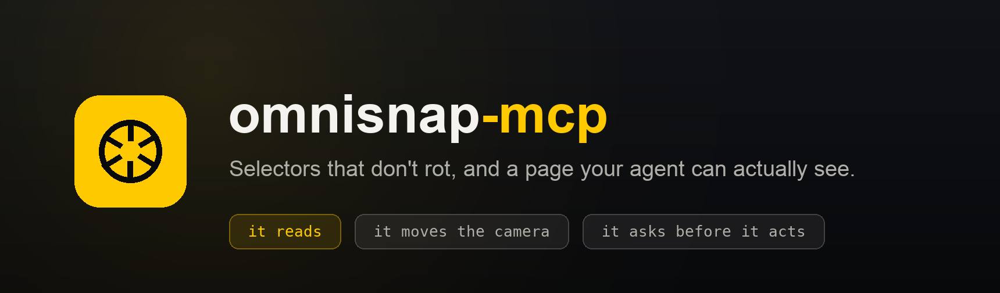

<p align="center">
  
</p>

<p align="center">
  <a href="https://github.com/developerpagadi/omnisnap-mcp/actions/workflows/ci.yml"></a>
  <a href="https://www.npmjs.com/package/omnisnap-mcp"></a>
  <a href="https://registry.modelcontextprotocol.io/v0.1/servers/io.github.developerpagadi%2Fomnisnap"></a>
  <a href="https://chromewebstore.google.com/detail/fjjfegkonlkleomaeopmakhlejjiljga"></a>
  <a href="LICENSE"></a>
</p>

## The problem this solves

Your agent writes a test. It reads the DOM, picks a selector that looks
reasonable, and the test passes. Three weeks later the bundler runs, a class
called `css-1x2y3z` becomes `css-9f8e7d`, and the suite goes red on a change
nobody made to the feature.

The selector was never good. Nothing in the DOM told the agent that.

Here is a real nav bar, read through this server:

```
 1. home                 84/100  unique   a[aria-label="home"]
 8. Sign In              88/100  unique   #IN
 2. Experience OneLern   44/100  unique   body.experience-body > div.navbar.w-nav
                                          > nav.nav-menu > a.nav-link:nth-of-type(1)
```

Eight links, two with a handle worth trusting and six with a positional chain
four levels deep. They all work today. Six of them break the first time
somebody reorders the menu, and **the score is what tells you which six.**

That is the whole idea. Not "here are some selectors", but "here is which one
will still be there next sprint, and why".

## Installing

Two pieces. The server you are reading about, and the Chrome extension that
does the actual reading.

**1. Add the server to your AI client.**

```json
{
  "mcpServers": {
    "omnisnap": {
      "command": "npx",
      "args": ["-y", "omnisnap-mcp"]
    }
  }
}
```

<details>
<summary><b>Where that file lives, per client</b></summary>

<br>

| Client | |
| --- | --- |
| **Claude Code** | `claude mcp add omnisnap -- npx -y omnisnap-mcp` |
| **Claude Desktop** | `~/Library/Application Support/Claude/claude_desktop_config.json` (macOS)<br>`%APPDATA%\Claude\claude_desktop_config.json` (Windows) |
| **Cursor** | `~/.cursor/mcp.json`, or `.cursor/mcp.json` in a project |
| **VS Code** | `.vscode/mcp.json`, or:<br>`code --add-mcp '{"name":"omnisnap","command":"npx","args":["-y","omnisnap-mcp"]}'` |
| **Windsurf** | `~/.codeium/windsurf/mcp_config.json` |
| **Cline** | `cline_mcp_settings.json`, through the MCP Servers pane |
| **Codex** | `~/.codex/config.toml` |
| **Goose** | Settings, Extensions, Add, as a stdio command |

Anything else that speaks MCP over stdio takes the same `command` and `args`.

</details>

**2. Install [OmniSnap AI Studio][store] from the Chrome Web Store.** Version
1.9 or later. The bridge lives in the extension, so an older build has no
**Connect to AI** switch and nothing will connect.

**3. Pair them, once.** Click the extension icon and turn on **Connect to AI**.
Ask your agent to call `omnisnap_status`; it reports a six-digit code. Type
that code into the extension.

```
You    → check omnisnap status

Claude → The extension is waiting to be paired.
         Tell the user the code is 482193, and ask them to type it
         into the extension, which is asking for it now.

You    → (type 482193 into the extension)

Claude → OmniSnap is connected.
           extension: omnisnap-extension 1.9.4
           bridge:    127.0.0.1:8787
         Every OmniSnap tool is available.
```

That is the setup. The pairing survives restarts.

[store]: https://chromewebstore.google.com/detail/fjjfegkonlkleomaeopmakhlejjiljga

## What it looks like in use

> **You:** The checkout button test keeps breaking. Have a look at the page and
> write me one that holds.

The agent calls `annotate_interactive`. It gets back a screenshot with every
control numbered, and a table mapping each number to a selector and a score.
It can see the page, so it knows which button you mean. It has the scores, so
it knows which handle survives.

```
 3. Place order   96/100  unique   [data-testid="place-order"]
 4. Cancel        41/100  2 matches  button.sc-bdVaJa
```

> **Claude:** Element 3 is the one you want. It has a test hook, which is the
> only kind of selector nothing about the design can move. Element 4 is worth
> knowing about separately: `button.sc-bdVaJa` matches two elements, so a test
> using it is already ambiguous.
>
> Here is the page object:

```ts
export class CheckoutPage {
  constructor(private page: Page) {}
  readonly placeOrder = this.page.getByTestId('place-order');
  readonly emailField = this.page.getByLabel('Email address');
}
```

No login script. No scripted navigation to reach the checkout. It read the
page you already had open, in the session you were already in.

<details>
<summary><b>Four more things worth trying</b></summary>

<br>

**"Why does this page feel slow?"** `get_diagnostics` returns Web Vitals,
failed requests and console errors from your real session, with your
extensions and your network, which a clean automated browser cannot reproduce.

**"Check this at phone width."** `set_viewport` holds the page at 375px, and
every tool afterwards answers about that width. Not a screenshot of a phone:
the page *is* a phone until you hand it back.

**"Watch while I click through this."** `watch_page` waits and reports the
console errors, failed requests and layout shifts that happen meanwhile. Every
other tool asks a question and gets an answer as of that instant; most of what
goes wrong does not wait to be asked.

**"Which button do you mean?"** `await_user_selection` arms the picker in the
browser. You click the element. The agent gets it back with ranked selectors.
Asking costs one turn. Guessing wrong costs the task.

</details>

## The tools

Twenty-two, in three tiers. The tier depends on who has to agree to it.

### 🟡 It reads

Nothing here changes your page.

| Tool | What you get |
| --- | --- |
| `annotate_interactive` | Numbered screenshot, a selector per number, and how much of the page you are seeing |
| `collect_selectors` | Every selector for one element, ranked and verified |
| `get_page_object` | A page object for Playwright, Selenium, Cypress or WebdriverIO |
| `verify_selectors` | Which of your existing selectors have rotted |
| `read_page` | The page as text, with a heading outline |
| `capture_page` · `capture_element` · `capture_matrix` | Screenshots, including three widths side by side |
| `get_diagnostics` | Vitals, failed requests, console errors, storage |
| `watch_page` | Waits, then reports what the page did meanwhile |
| `get_design_tokens` | Palette with contrast audit, type scale, spacing |
| `measure_accessibility` | WCAG failures, with selectors |
| `inspect_element` | Box model and computed styles |
| `list_tabs` · `omnisnap_status` | What can be read, and whether the bridge is healthy |

### ⚪ It moves the camera

These change what is on screen, not what the page contains. They are declared
as changes rather than reads, so your client can prompt if it wants to.

| Tool | |
| --- | --- |
| `scroll_to` | See the rest of the page. One capture covers one viewport, which on a long page is a few per cent of it |
| `set_viewport` | Hold the page at 375, 768 or 1440 |
| `set_color_scheme` | Light or dark. Dark is where contrast regressions hide, because it is the theme nobody screenshots |
| `hover` · `focus_element` | Photograph a dropdown, a tooltip, a focus ring. No ordinary capture reaches these |

### 🔴 It asks before it acts

| Tool | |
| --- | --- |
| `propose_action` | Proposes a click or a keystroke. The extension outlines the element and asks you, in the page. Nothing happens unless you approve |
| `await_user_selection` | Hands the question back. You click the element you mean |

Once an element has a number from `annotate_interactive`, **every tool above
also takes `element: 5`** instead of a selector you would otherwise copy out of
a table and retype exactly.

## How this is different

Several projects connect an agent to your real Chrome through an extension, so
the category is not empty. Tools like Playwright MCP and Chrome DevTools MCP
drive a browser: they click, type and navigate.

This one reads your browser, and asks before it touches it. What comes back is
not a driven session but the artefacts of a handoff.

| | A driven browser | omnisnap-mcp |
| --- | --- | --- |
| Reaching a page behind SSO | Write a login script | Already in the tab |
| Selector quality | Whatever the DOM suggests | Scored for surviving a redeploy, with the reason |
| Ambiguous selectors | Found when the suite goes flaky | Counted against the live DOM before you see it |
| Acting on your session | The agent decides | You approve, in the page |
| Output | A session that was driven | Page objects, tokens, redlines, diagnostics |

The trade is deliberate. An agent that can click unattended in a session you
are signed into will eventually click the wrong thing, and the cost lands on
real data rather than a fixture.

## Prompts and resources

Four slash commands: `/write-test`, `/file-bug`, `/audit-accessibility`,
`/extract-design-system`.

| Resource | |
| --- | --- |
| `omnisnap://guide/selectors` | The ranking and the reasoning: what makes a selector fragile, and how the right choice differs per framework |
| `omnisnap://guide/diagnostics` | What the vitals mean, and the two mistakes that produce confidently wrong bug reports |
| `omnisnap://capture/latest` | The most recent screenshot and its metadata |
| `omnisnap://help/pairing` | Install and pairing steps |

The first two work before you have paired anything. Any server can hand back a
list of selectors; knowing which to pick is what decides whether the test
passes next sprint, so the reasoning travels with the data.

## When something is wrong

```bash
npx omnisnap-mcp --doctor
```

It checks the port, checks whether a token is stored, waits for the extension,
then walks you through pairing: it prints the code to type in and waits for it
to land.

| What you see | What it means |
| --- | --- |
| Every tool says "not paired" | The extension is not connected. Run `--doctor`. |
| No **Connect to AI** switch in the popup | The installed extension is older than 1.9. Update it. |
| `omnisnap_status` names tools that will refuse | Same cause. It lists exactly which ones. |
| "Port already in use" | Another copy is running, which is usually fine. Close it, or set `--port` in both the client config and the extension. |
| "Chrome does not allow extensions to read…" | The focused tab is a `chrome://` page or the Web Store. Switch to an ordinary site. |
| Tools time out after 30s | The browser is busy, or too many calls were sent at once. At most six run in flight. |

## Security

You are pairing a tool that can read any page you are signed in to. That
deserves a straight answer.

- **Loopback only.** The bridge binds `127.0.0.1`. Nothing off the machine can
  reach it.
- **No web page can connect.** The server requires a `chrome-extension://`
  origin. A browser sets that header itself and page JavaScript cannot forge
  it.
- **Acting needs a human, every time.** The extension outlines the element and
  asks you. The Approve control accepts only `event.isTrusted`: a page can
  dispatch a click on that button from script, but it cannot forge a real one.
  Nothing navigates, and nothing submits a form.
- **Pairing needs a human.** The port is fixed, so another local process could
  claim it first. The six-digit code therefore travels from this server to you
  through your AI client, and you type it in. **If your client is not showing
  a code, type nothing: something else is listening.**
- **The code never crosses the socket.** A rogue client would otherwise read it
  back and pair itself. A test asserts this.
- **Rate limited and short lived.** Six digits, five attempts, two minutes,
  single use. Constant-time comparison against a fixed-width buffer, so neither
  value nor length leaks.
- **No telemetry.** No account, no remote config. The only state on disk is the
  pairing token at `~/.omnisnap/bridge.json`, mode `0600`.

**This is not a security boundary.** It is deliberate limits with a person in
the loop. Anyone who can run processes as you can read that token, and an AI
client you pair is a program you have chosen to trust with your browser. Treat
it the way you would treat handing that client your terminal.

Full detail in [SECURITY.md](SECURITY.md); the wire format is in
[PROTOCOL.md](PROTOCOL.md).

## Configuration

Every option is a flag and an environment variable. A flag wins, because it
sits in the client config in front of you, where the environment may have come
from a shell profile written months ago.

```json
"args": ["-y", "omnisnap-mcp", "--port", "8787", "--log-level", "debug"]
```

| Flag | Environment | Default | |
| --- | --- | --- | --- |
| `--port` | `OMNISNAP_PORT` | `8787` | Must match the extension |
| `--log-level` | `OMNISNAP_LOG_LEVEL` | `info` | `silent`, `error`, `warn`, `info`, `debug` |
| `--state-dir` | `OMNISNAP_STATE_DIR` | `~/.omnisnap` | Where the pairing token lives |
| `--call-timeout` | `OMNISNAP_CALL_TIMEOUT_MS` | `30000` | Per call |
| `--capture-timeout` | `OMNISNAP_CAPTURE_TIMEOUT_MS` | `120000` | Captures get longer |
| `--max-concurrent-calls` | `OMNISNAP_MAX_CONCURRENT_CALLS` | `6` | In flight at once |
| `--max-image-bytes` | `OMNISNAP_MAX_IMAGE_BYTES` | `8388608` | Past this a capture is refused rather than sent |
| `--pairing-ttl` | `OMNISNAP_PAIRING_TTL_MS` | `120000` | How long a code lasts |
| | `OMNISNAP_MAX_FRAME_BYTES` | `25165824` | Any single message from the extension |

`omnisnap-mcp --help` prints the same list with defaults resolved on your
machine.

<details>
<summary><b>Limits, and why each one is there</b></summary>

<br>

There is one browser at the other end, and much of what it does is serialised.
Chrome allows two screenshots a second, and a prompt waiting on a person cannot
be had twice. A fan-out of twenty calls is therefore refused at six, rather
than becoming a queue whose last entries time out having never been reached.

Screenshots come back as JPEG with the long edge at 1536px, roughly 100KB for a
viewport. Vision models downscale to about that anyway, so anything larger is
paid for and then discarded.

`read_page` returns 12,000 characters by default and 60,000 on request, which
costs a fortieth of a picture when the question is what the page says.
`annotate_interactive` numbers at most 60 elements, since a picture with two
hundred badges on it is no longer a map. `verify_selectors` takes 200 selectors
at a time. `watch_page` runs up to 120 seconds, records 60 events of each kind,
and only one watch may run on a page at a time.

Logs go to stderr, always. Stdout carries the protocol, and one stray write
corrupts the session, so a test spawns the real binary and asserts every line
it emits parses as JSON-RPC.

</details>

## Requirements

- Node.js 18 or newer
- Google Chrome, with [OmniSnap AI Studio][store] 1.9 or later
- Any MCP client that speaks stdio

## Development

```bash
npm install
npm test
```

40 tests cover pairing and its failure modes, origin rejection, the bridge end
to end against a fake extension, the stdio contract, the concurrency limit, and
that every option works as a flag, as an environment variable, and in the right
order of precedence.

Two things the suite cannot check are whether the extension's service worker
registers and whether a tool behaves against a real page:

```bash
node scripts/verify-live.mjs
```

`tests/extension.test.js` runs the Chrome extension's own bridge module,
unmodified, against a real server, so the two halves cannot drift apart
unnoticed. It skips unless the extension is checked out beside this repository.

## Contributing

Bug reports and pull requests are welcome.
[CONTRIBUTING.md](CONTRIBUTING.md) covers the setup and the house style,
including the one constraint worth knowing before you write anything: tools
that let the agent act without a person in the loop will not be merged.

Security problems should go through
[private reporting](https://github.com/developerpagadi/omnisnap-mcp/security/advisories/new)
rather than a public issue.

## Licence

MIT. Playwright, Chrome and any other product named here are trademarks of
their respective owners, referred to only for comparison.
